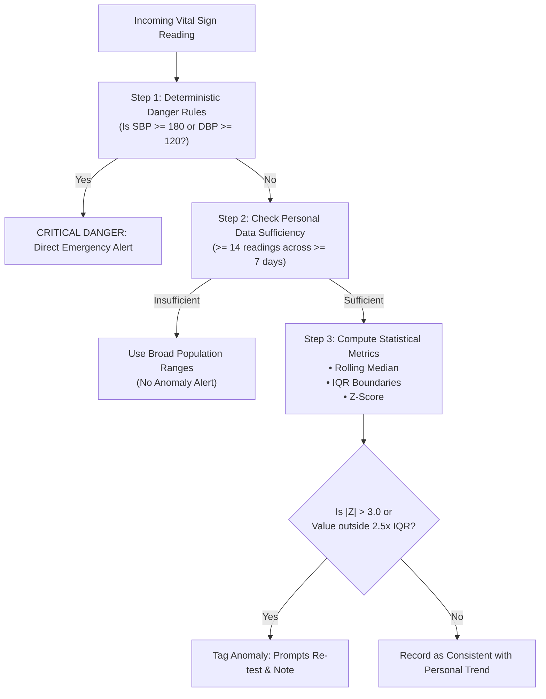

# CardioGuard AI — Personal Baseline Anomaly Detection

> [!IMPORTANT]
> **Clinical Clarification**:  
> The anomaly detection module detects **statistical divergence** from an individual's past measurements. An anomaly notification indicates an atypical measurement that may warrant repeating the reading or consulting a physician; it is **NOT** a clinical diagnosis or confirmation of pathology.

---

## 1. Baseline Philosophy: Longitudinal Personalization

Human cardiovascular physiology varies significantly across individuals. An athletic resting heart rate of $48\text{ bpm}$ is normal for an endurance runner but potentially symptomatic bradycardia for a sedentary adult. Conversely, a resting heart rate of $95\text{ bpm}$ may be normal for one individual but an acute tachycardia surge for another.

CardioGuard AI employs a **personal baseline methodology** rather than relying solely on population averages.

---

## 2. Statistical Methodology

### 2.1 Minimum Data Requirements
To prevent spurious outlier alarms during initial onboarding:
- Minimum of **14 validated readings** recorded across at least **7 unique calendar days**.
- Context-aware filtering: Readings labeled `post_exercise` are segregated and not mixed into resting baselines.

### 2.2 Dual-Tier Statistical Formulation
To safeguard against skewed non-Gaussian distributions (e.g., occasional white-coat spikes):

1. **Non-Parametric Interquartile Range ($IQR$) Threshold**:
   - $Q_1$: 25th percentile of the rolling 30-day window.
   - $Q_3$: 75th percentile of the rolling 30-day window.
   - $IQR = Q_3 - Q_1$.
   - **Outlier Boundary**:
     $$\text{Lower Limit} = Q_1 - 2.5 \times IQR$$
     $$\text{Upper Limit} = Q_3 + 2.5 \times IQR$$

2. **Parametric Z-Score ($Z$)**:
   - Rolling mean $\mu$ and standard deviation $\sigma$.
   - $$Z = \frac{x - \mu}{\sigma}$$
   - Flagged when $|Z| > 3.0$ (representing values beyond $99.7\%$ of historical observations).

---

## 3. Anomaly Categories & User Guidance

When an anomaly is flagged, the user receives structured, non-alarmist feedback:

| Vital | Example Anomaly | System Feedback (Non-Alarmist) |
|---|---|---|
| **Heart Rate** | Resting HR is 28 bpm above 30-day median | *"Your resting heart rate today is noticeably higher than your usual baseline (avg 68 bpm). Consider resting for 5 minutes and taking another measurement. If you feel dizzy or short of breath, tap Emergency."* |
| **Blood Pressure** | Systolic BP jumps from usual 122 to 158 mmHg | *"This reading is higher than your recent trend. Ensure your cuff is placed at heart level, rest quietly, and repeat in 10 minutes. Discuss ongoing elevation with your physician."* |

---

## 4. Limitations & False Positive Mitigation

1. **Measurement Error**: An improperly fitted blood pressure cuff or loose smartwatch sensor is the leading cause of statistical anomalies. The UI always instructs the user to check cuff position and repeat the measurement before acting.
2. **Behavioral Confounders**: Acute stress, caffeine intake, dehydration, lack of sleep, or recent exercise can trigger statistical outliers without acute cardiovascular illness.
3. **No Diagnostic Implication**: A flagged reading does not equate to heart failure, arrhythmia, or hypertension. It is purely a trigger for mindful re-measurement or longitudinal clinical review.
