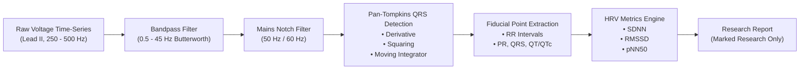

# CardioGuard AI — ECG Signal Analysis Architecture (Research Pipeline)

> [!CAUTION]
> **RESEARCH USE ONLY (RUO) NOTICE**:  
> The ECG signal analysis module is an **experimental research module**. It has **NOT** undergone clinical trial validation, clearance by the US FDA, or CE-mark certification as software-as-a-medical-device (SaMD). It must **never** be used for diagnostic triage, arrhythmia detection in acute care, or treatment decisions.

---

## 1. Overview & Research Scope

CardioGuard AI includes an experimental signal processing pipeline designed to ingest digital electrocardiogram (ECG) voltage tracings, perform baseline filtering, locate fiducial markers (QRS complexes), and compute statistical Heart Rate Variability (HRV) metrics.

---

## 2. Processing Pipeline Architecture

### Stage 1: Digital Filtering
- **Baseline Wander Suppression**: High-pass filtering with cutoff at $0.5\text{ Hz}$ to eliminate respiratory baseline shifts and galvanic skin potential.
- **High-Frequency Noise Suppression**: Low-pass filtering with cutoff at $45.0\text{ Hz}$ to filter muscle tremor (electromyography) artifacts.
- **Powerline Notch Filter**: Infinite impulse response (IIR) notch filter at $50\text{ Hz}$ (standard for India and Europe) or $60\text{ Hz}$ (Americas).

### Stage 2: QRS Detection (Pan-Tompkins Method)
- Realizes differential filtering, non-linear point squaring to accentuate high-frequency QRS energy, and moving window integration ($150\text{ ms}$).
- Adaptive dual-threshold state machine detects R-peaks while minimizing false triggers on peaked T-waves.

### Stage 3: Rhythm & HRV Extraction
- **Heart Rate**: Instantaneous and mean ventricular rate based on $RR$ intervals ($HR = 60 / RR_{\text{mean}}$).
- **Time-Domain HRV**:
  - $SDNN$: Standard deviation of $NN$ intervals (overall autonomic tone).
  - $RMSSD$: Root mean square of successive differences (parasympathetic modulation).
  - $pNN50$: Percentage of successive $NN$ intervals differing by $>50\text{ ms}$.
- **QTc Calculation**: Corrected QT interval using Bazett’s formula ($QTc = QT / \sqrt{RR}$) and Fridericia’s formula ($QTc = QT / \sqrt[3]{RR}$).

---

## 3. Regulatory Status & Absence of Clinical Validation

- **Clinical Status**: Unvalidated research prototype.
- **Known Limitations**:
  - Susceptible to motion artifacts and lead misplacement.
  - Cannot reliably distinguish complex ventricular arrhythmias (e.g., Ventricular Tachycardia vs. SVT with aberrancy).
  - ST-segment deviation analysis is disabled due to high false-positive rates on single-lead recordings.
- **Enforced Safety Guard**: The API response explicitly tags every output with `validation_status: "UNVALIDATED_RESEARCH_ONLY"` and raises warnings if used in an emergency context.

---

## 4. Requirements for Future Clinical Validation

Before any future clinical deployment or regulatory submission (e.g., FDA 510(k) or SaMD Class IIa):
1. **Clinical Multicenter Study**: Prospective cohort comparing algorithm annotations against three independent, blinded board-certified cardiologists.
2. **Benchmark Datasets & Licensing**:
   - Validation against the **MIT-BIH Arrhythmia Database** (PhysioNet, ODC-BY license).
   - Validation against the **PTB-XL ECG Database** (12-lead ECG dataset with annotated diagnostic statements).
   - Validation against **AHA ECG Database** (ECRI / American Heart Association).
3. **Statistical Acceptance Criteria**:
   - QRS Detection Sensitivity: $\ge 99.5\%$.
   - QRS Detection Positive Predictivity: $\ge 99.5\%$.
   - Atrial Fibrillation Detection: Sensitivity $\ge 95\%$, Specificity $\ge 98\%$.
4. **Hardware Interoperability**: Testing across standardized 1-lead and 12-lead acquisition hardware adhering to IEC 60601-2-25 / 60601-2-47.
