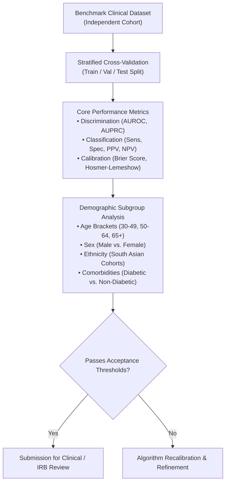

# CardioGuard AI — Model Evaluation Framework & Validation Standards

> [!CAUTION]
> **Zero Fabrication Policy**:  
> In accordance with healthcare AI engineering ethics, CardioGuard AI does **not** publish, fabricate, or simulate clinical accuracy metrics (such as fake AUROC or sensitivity numbers) without audited retrospective or prospective clinical validation on approved cohorts. All metrics outlined herein define the **evaluation methodology** required prior to any future clinical deployment.

---

## 1. Evaluation Methodology for Clinical AI

Clinical machine learning models must be assessed using multidimensional metrics that evaluate discriminatory power, clinical utility, and calibration consistency.

---

## 2. Quantitative Evaluation Metrics

### 2.1 Discrimination
- **Area Under the Receiver Operating Characteristic (AUROC / C-Index)**:
  Measures the model's ability to rank patients who experience cardiovascular events higher than those who do not.
- **Area Under the Precision-Recall Curve (AUPRC)**:
  Critical for low-prevalence outcome cohorts where standard AUROC can be misleadingly optimistic.

### 2.2 Clinical Classification Metrics
At pre-specified decision thresholds ($\tau$):
- **Sensitivity (Recall)**:
  $$\text{Sensitivity} = \frac{TP}{TP + FN}$$
  *Target in safety-critical cardiac triage: $\ge 95\%$ to minimize false negatives.*
- **Specificity**:
  $$\text{Specificity} = \frac{TN}{TN + FP}$$
- **Positive Predictive Value (PPV / Precision)**:
  $$\text{PPV} = \frac{TP}{TP + FP}$$
- **Negative Predictive Value (NPV)**:
  $$\text{NPV} = \frac{TN}{TN + FN}$$
  *Ensures that a "low risk" designation reliably reflects low probability.*

### 2.3 Calibration & Reliability
A model with high AUROC can still provide inaccurate probability estimates if it is poorly calibrated.
- **Calibration Curves**: Plot of predicted probabilities against observed event frequencies across deciles of risk.
- **Brier Score**:
  $$\text{Brier} = \frac{1}{N} \sum_{i=1}^N (P_i - Y_i)^2$$
- **Expected Calibration Error (ECE)**: Weighted average difference between predicted and empirical risk across bins.

---

## 3. Mandatory Subgroup & Bias Auditing

Algorithms in cardiovascular medicine often exhibit performance degradation in under-represented populations. Any formal model evaluation of CardioGuard AI components must report:
1. **Biological Sex**: Differences in sensitivity for female patients presenting with atypical myocardial infarction symptoms (e.g., nausea, jaw pain, dyspnea without chest heaviness).
2. **Age Stratification**: Performance across younger cohorts ($<45\text{ yrs}$) vs. elderly cohorts ($\ge 65\text{ yrs}$).
3. **Ethnicity & Ancestry**: Dedicated evaluation on South Asian cohorts to evaluate Framingham risk underestimation.
4. **Comorbid Profiles**: Accuracy in the presence of type 2 diabetes mellitus and chronic kidney disease.

---

## 4. Pre-Requisites for Clinical Software Accreditation

Before transitioning from research to clinical deployment:
1. **Institutional Review Board (IRB) Approval**: Formal protocol approved by an accredited ethical oversight committee.
2. **Standard of Truth / Ground Truth Adjudication**: Independent consensus labeling by at least three board-certified cardiologists.
3. **Reproducibility Code Freeze**: Hashing of data pipelines, model weights, and software dependencies to ensure deterministic verification.
4. **Software-as-a-Medical-Device (SaMD) Verification**: Compliance with IEC 62304 life cycle processes and ISO 14971 risk management standards.
