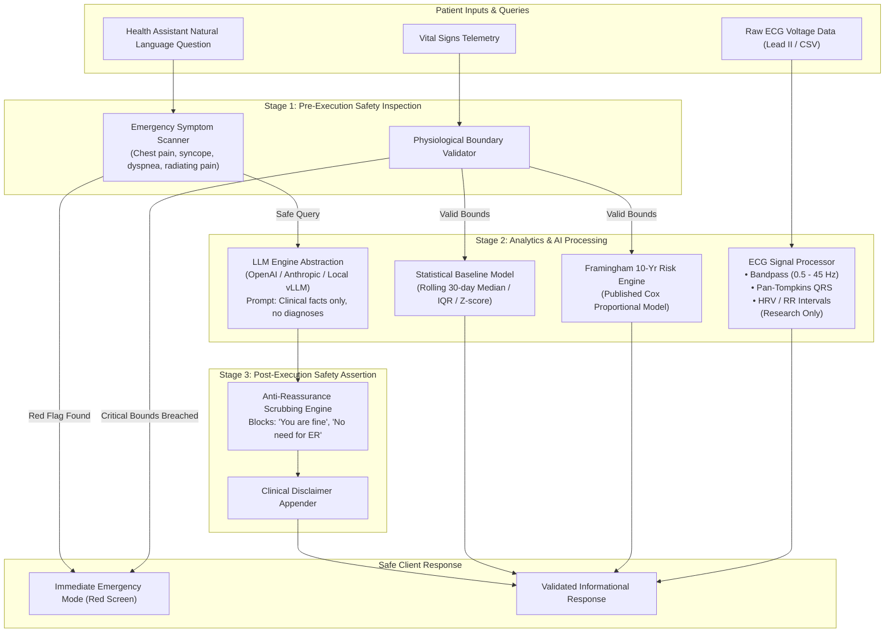

# CardioGuard AI — AI Subsystem Architecture

> [!CAUTION]
> **Clinical Governance Rule**: Probabilistic AI models and Large Language Models (LLMs) are **untrusted components** in safety-critical pathways. All system outputs presented to patients or clinicians must pass through deterministic clinical safety filters before delivery.

---

## 1. Subsystem Scope & Core Design Tenets

The AI and Analytics Subsystem in CardioGuard AI consists of four distinct components:
1. **Cardiovascular Risk Calculator**: Purely deterministic implementation of published epidemiological equations (Framingham Heart Study).
2. **ECG Signal Analysis Pipeline**: Digital signal processing (DSP) and feature extraction engine for research purposes only.
3. **Personal Baseline Anomaly Detector**: Statistical outlier detector operating on rolling biometric history.
4. **Health Assistant with Safety Guard**: Natural language query engine using an LLM provider abstraction layer shielded by strict input/output safety filters.

---

## 2. Component Specifications

### 2.1 Framingham 10-Year Cardiovascular Risk Calculator
- **Nature**: Deterministic mathematical formulation (not machine learning).
- **Source**: D’Agostino RB Sr, Vasan RS, Pencina MJ, et al. *General Cardiovascular Risk Profile for Use in Primary Care: The Framingham Heart Study*. Circulation. 2008;117(6):743-753.
- **Inputs**:
  - Age (years, 30–74)
  - Biological Sex (Male/Female)
  - Total Cholesterol (mg/dL)
  - HDL Cholesterol (mg/dL)
  - Systolic Blood Pressure (mmHg)
  - Antihypertensive Medication status (Boolean)
  - Current Smoker status (Boolean)
  - Diabetes Mellitus status (Boolean)
- **Output**: 10-year risk percentage, risk category (Low <10%, Intermediate 10-19%, High $\ge$20%), and vascular "Heart Age".
- **Safety Safeguard**: Fixed equation with zero model drift, zero hallucination risk, and complete mathematical auditability.

### 2.2 ECG Analysis Pipeline (Research Only)
- **Status**: **RESEARCH ONLY — NO CLINICAL ACCREDITATION**.
- **Pipeline Architecture**:
  1. *De-noising*: Zero-phase Butterworth bandpass filter ($0.5\text{ Hz} - 45\text{ Hz}$) to eliminate baseline wander and high-frequency EMG noise.
  2. *QRS Detection*: Implementation of the Pan-Tompkins algorithm (differentiation, squaring, moving window integration, adaptive thresholding).
  3. *Morphology Extraction*: PR interval, QRS duration, QT / QTc calculation (Bazett and Fridericia corrections).
  4. *HRV Metrics*: Time-domain HRV statistics ($SDNN$, $RMSSD$, $pNN50$).
- **Safeguard**: All ECG responses include a mandatory JSON header: `{"status": "research_only", "clinical_use": false, "disclaimer": "Not an FDA/CE medical diagnostic. Confirm with a calibrated 12-lead ECG interpreted by a licensed cardiologist."}`.

### 2.3 Personal Baseline Anomaly Detection
- **Approach**: Non-parametric statistical anomaly tracking against an individual patient's own historical distribution.
- **Methodology**:
  - Requires a minimum of 14 valid data points over 7 distinct days before establishing a baseline.
  - Computes rolling Median, Interquartile Range ($IQR$), Mean ($\mu$), and Standard Deviation ($\sigma$).
  - Evaluates an incoming reading:
    $$Z = \frac{x - \mu_{\text{rolling}}}{\sigma_{\text{rolling}}}$$
  - Flags readings where $|Z| > 3.0$ or values outside $[Q_1 - 2.5 \times IQR, Q_3 + 2.5 \times IQR]$.
- **Distinction**: Flags *statistical anomalies* to encourage re-measurement or conversation with a physician, but explicitly disclaims diagnostic conclusions.

### 2.4 Health Assistant with Layered LLM Safety
- **Provider Abstraction**: A unified interface (`BaseLLMProvider`) supporting pluggable backends:
  - `OpenAIProvider` (e.g., GPT-4o-mini)
  - `AnthropicProvider` (e.g., Claude 3.5 Haiku)
  - `MockLLMProvider` (local testing and offline deterministic fallbacks)
- **Safety Architecture**:
  1. **Pre-LLM Inspection**: The prompt is analyzed via deterministic regex and rule tables for acute symptoms (e.g., "chest pain", "tightness in chest", "shortness of breath", "numbness in left arm"). If any match occurs, the LLM call is **aborted completely**, and the system returns immediate emergency protocol instructions.
  2. **System Prompt Hardening**: The LLM is instructed in system prompts to act strictly as a patient educator, never provide definitive medical diagnosis, never prescribe medications, and always suggest consulting a physician.
  3. **Post-LLM Output Filtering**: The generated text is scanned for forbidden reassuring phrases (e.g., "you are completely fine", "no need to worry", "it is definitely just heartburn"). If detected, the response is discarded and replaced with a conservative safety fallback.
