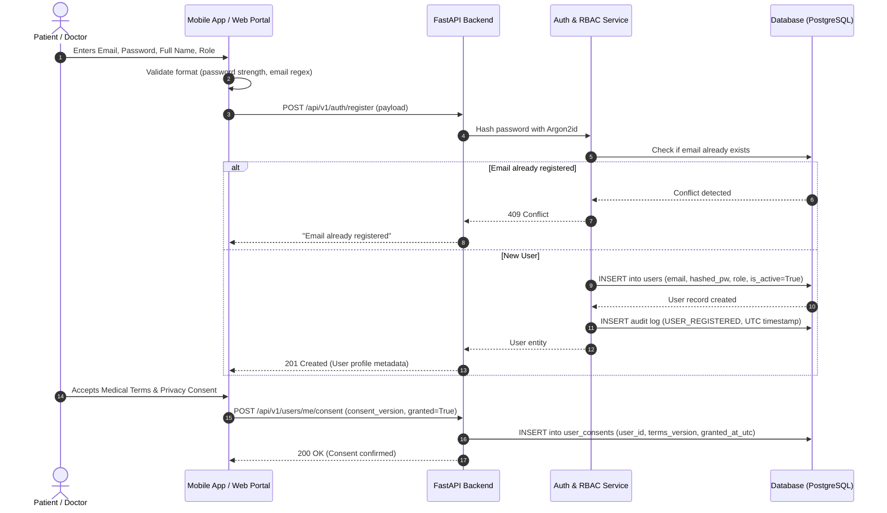
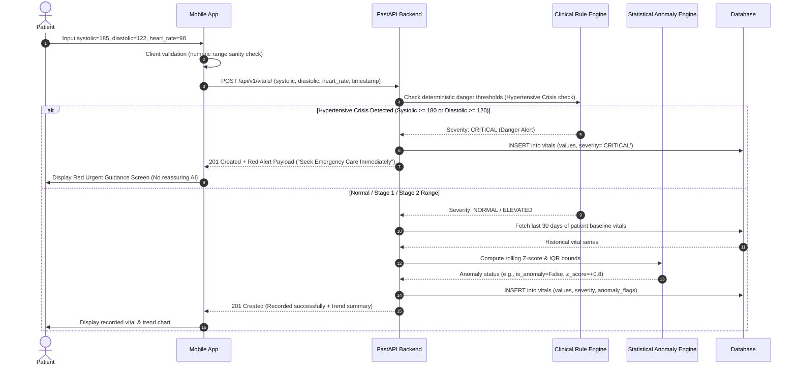
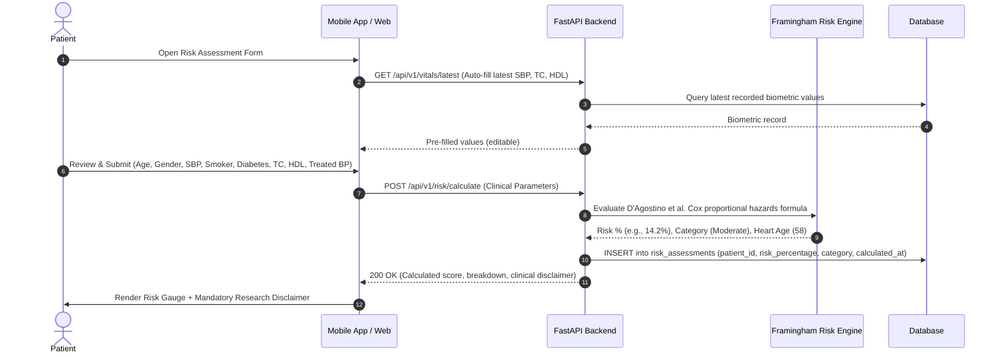
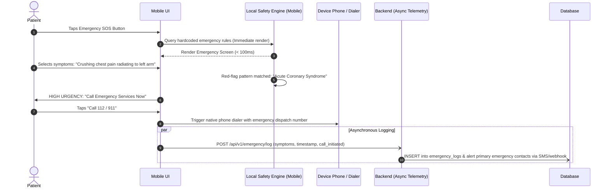
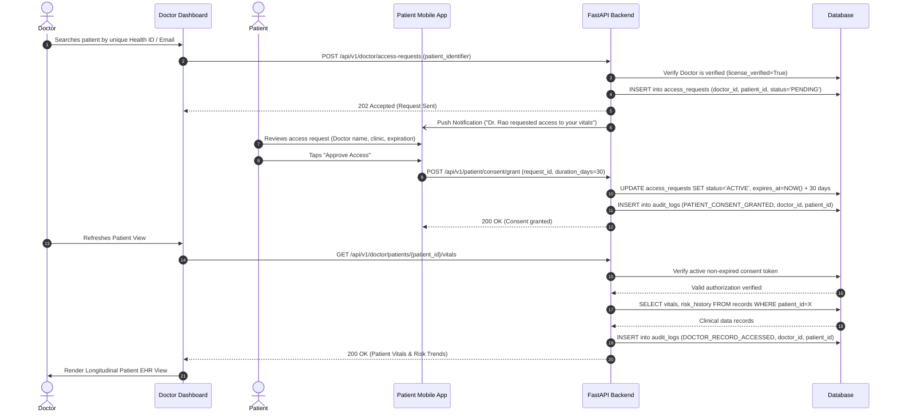

# CardioGuard AI — Data Flow Specifications

> [!IMPORTANT]
> **Safety Notice**: All workflows enforce explicit patient consent and data privacy. Emergency guidance pathways are engineered for immediate local response to bypass network lag during life-threatening events.

---

## 1. User Registration & Onboarding Flow

This sequence handles secure account creation for both Patients and Physicians, ensuring cryptographic password hashing, role assignment, and mandatory clinical consent acceptance.

---

## 2. Vital Sign Recording & Anomaly Detection Flow

When a user logs a vital sign (e.g., Blood Pressure, Heart Rate, SpO2, Blood Glucose), the data is validated against physical bounds, evaluated against deterministic danger limits, checked against their personal statistical baseline, and stored.

---

## 3. Cardiovascular Risk Assessment Flow (Framingham)

Calculates the 10-year risk of developing cardiovascular disease using the standardized Framingham Heart Study equation (D’Agostino et al., 2008).

---

## 4. Emergency Guidance Flow (Zero Latency & Offline-Ready)

Emergency triage must be instantaneous. The mobile application evaluates critical red-flag symptoms locally without waiting for server responses.

---

## 5. Doctor Access & Patient Consent Flow

Data isolation mandates that doctors cannot view any patient's records without explicit, revocable patient authorization.

