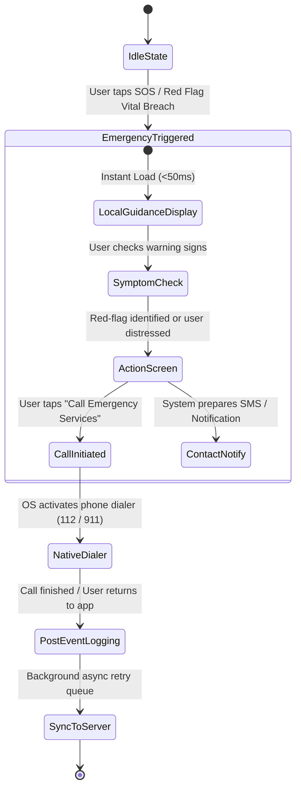

# CardioGuard AI — Emergency Flow Architecture

> [!CAUTION]
> **CRITICAL MEDICAL PRINCIPLE**: Acute cardiovascular events (such as Acute Myocardial Infarction or Aortic Dissection) are time-critical medical emergencies. Under NO circumstances may the application provide reassurance based on normal vitals, historical ECGs, or low Framingham risk scores when red-flag symptoms are present.

---

## 1. Core Safety Tenets

1. **Zero-Latency Execution**: The emergency guidance screen must load in under 100 milliseconds. It must not block on remote network roundtrips, database queries, or external API calls.
2. **Offline-First Functionality**: All critical decision rules, emergency symptoms checklist, and dialing shortcuts are compiled directly into the client mobile binary.
3. **Absolute Prohibition of False Reassurance**: Normal vital sign readings (e.g., normal blood pressure or heart rate) **do not rule out an acute coronary syndrome**. The application strictly prohibits text such as *"Your vitals look normal, so you're probably okay"*.
4. **Immediate Action Over Deliberation**: The primary visual affordance is an immediate one-tap trigger for emergency dispatch (112 / 108 / 911).

---

## 2. Emergency Workflow States



---

## 3. Step-by-Step Flow Specification

### Step 1: Triggering Emergency Mode
Emergency mode can be activated via:
- **Direct User Action**: Tapping the high-contrast red "Emergency SOS" button pinned to the mobile navigation bar and dashboard.
- **Automated Vital Sign Trigger**: Submitting a vital sign that breaches critical physiological limits (e.g., Systolic BP $\ge 180\text{ mmHg}$ or Diastolic BP $\ge 120\text{ mmHg}$ accompanied by acute headache or chest discomfort).
- **Health Assistant Red-Flag Match**: Typing or voicing acute symptoms (e.g., "crushing chest pain", "pain shooting down left arm", "sudden difficulty breathing").

### Step 2: Instantaneous Offline Guidance Screen
- The screen is rendered entirely from static assets bundled in the application bundle.
- Displays unambiguous, high-contrast, large-format instructions:
  - **STOP ALL PHYSICAL ACTIVITY IMMEDIATELY** and sit down or lie down with the head slightly elevated.
  - **DO NOT DRIVE YOURSELF TO THE HOSPITAL**.
  - **CALL EMERGENCY SERVICES (112 / 108 / 911) IMMEDIATELY**.

### Step 3: Rapid Symptom Selection (Optional & Non-Blocking)
The user can tap checkboxes for common acute warning signs (this takes $< 5$ seconds and never blocks the call button):
- [ ] Chest pain, pressure, fullness, or squeezing in the center of the chest.
- [ ] Pain or discomfort spreading to shoulders, neck, jaw, back, or one or both arms.
- [ ] Sudden shortness of breath with or without chest discomfort.
- [ ] Cold sweats, dizziness, lightheadedness, or sudden unexplained fainting.

If *any* checkbox is tapped, the interface highlights in pulsing amber/red with the message:
> **"These symptoms strongly suggest an urgent medical condition. Call emergency services now."**

### Step 4: Emergency Call Action
- A prominent button **"CALL EMERGENCY SERVICES (112 / 911)"** uses native OS deep-linking (`tel:112` or user's localized emergency dispatch number).
- Prompts native telephone dialing without requiring manual digit entry.

### Step 5: Automated Emergency Contact Notification
- The mobile app retrieves pre-configured emergency contacts stored in the device's secure enclave (`expo-secure-store`).
- Formats an SMS / push notification containing:
  - Patient Name
  - Timestamp (UTC)
  - Pre-selected symptoms
  - GPS coordinates / reverse-geocoded address (subject to user's device permissions)
- In the background, queues dispatch via cellular SMS or the backend notification service.

### Step 6: Post-Event Telemetry & Audit Logging
- Once the emergency state terminates or is dismissed, an event record is generated locally:
  ```json
  {
    "event_type": "EMERGENCY_TRIGGERED",
    "timestamp_utc": "2026-10-17T15:20:00Z",
    "trigger_source": "MANUAL_SOS_BUTTON",
    "symptoms_checked": ["chest_pressure", "left_arm_radiation"],
    "call_dispatched": true,
    "dialed_number": "112",
    "offline_triggered": false
  }
  ```
- The record is persisted in SQLite / local storage and queued for asynchronous synchronization with `POST /api/v1/emergency/log`.

---

## 4. Failure Mode Handling

| Failure Scenario | System Behavior |
|---|---|
| **No Cellular Network / WiFi** | Local static UI functions normally; native emergency call works via cellular carrier emergency roaming (standard GSM 112/911 protocols bypass lack of data). Event log is saved locally for deferred sync. |
| **Backend API Downtime (500/503)** | Emergency screen does NOT depend on backend. Logging task retries with exponential backoff without alerting or delaying the patient. |
| **Device in Battery Saver Mode** | Animations disabled; high-contrast high-visibility layout remains fully interactive. |
| **User Cancels or Dismisses Screen** | System asks: *"Are you sure? If you are still experiencing chest discomfort or shortness of breath, please call emergency services immediately."* Logs the cancellation event. |
