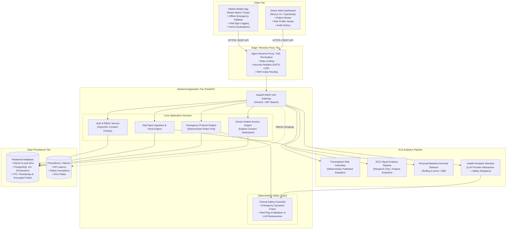

# CardioGuard AI — System Architecture

> [!IMPORTANT]
> **Medical Disclaimer**: CardioGuard AI is a clinical research and educational decision-support platform. It is **not** an FDA-approved or CE-marked medical device, cannot make definitive clinical diagnoses, and must not supersede professional clinical evaluation or emergency medical triage.

---

## 1. Executive Overview

CardioGuard AI is an intelligent cardiovascular monitoring, risk stratification, and emergency guidance platform. The platform is designed with a defense-in-depth safety paradigm: **deterministic clinical safety rules strictly override probabilistic machine learning / LLM inferences**.

The platform enables:
1. Continuous and periodic vital sign tracking (Blood Pressure, Heart Rate, SpO2, Blood Glucose).
2. Cardiovascular risk estimation via published clinical equations (Framingham 10-Year CVD Risk Equation).
3. Zero-latency offline emergency triage guidance for patients experiencing acute cardiac warning symptoms.
4. Secure clinical data access for verified medical practitioners via a dedicated physician dashboard.

---

## 2. Monorepo Structure

The repository follows a clean, modular monorepo structure separating concerns across backend services, clinical AI components, client frontends, and cross-cutting documentation and infrastructure:

```
HeartCare AI/
├── backend/                  # FastAPI Application, SQLAlchemy ORM, Alembic migrations
│   ├── app/
│   │   ├── api/              # Versioned API routes (auth, vitals, risk, emergency, doctor)
│   │   ├── core/             # Configuration, security, JWT, rate limiting
│   │   ├── models/           # SQLAlchemy DB entities
│   │   ├── schemas/          # Pydantic request/response schemas
│   │   ├── services/         # Business logic & safety rule evaluations
│   │   └── main.py           # Application entrypoint
│   ├── alembic/              # Database migration scripts
│   └── tests/                # Unit and integration test suite
├── ai/                       # Clinical algorithms & machine learning pipelines
│   ├── risk/                 # Deterministic Framingham risk calculator
│   ├── ecg/                  # Research-only ECG analysis pipeline
│   ├── anomaly/              # Statistical baseline anomaly detection
│   └── assistant/            # Health assistant LLM interface with safety guards
├── frontend/
│   ├── mobile/               # Patient application (React Native + Expo)
│   └── doctor-dashboard/     # Physician portal (Next.js 14 App Router, TailwindCSS)
├── docs/                     # System, clinical, API, AI, and product documentation
├── infrastructure/           # Nginx reverse proxy, Docker, Prometheus configs
├── security/                 # Threat models, access control, privacy policies
├── tests/                    # E2E, security, and performance test suites
└── Makefile                  # Developer workflow automation
```

---

## 3. High-Level Component Architecture



---

## 4. Subsystem Details

### 4.1 Backend (FastAPI + SQLAlchemy + Alembic)
- **FastAPI**: Asynchronous Python ASGI framework providing auto-generated OpenAPI schemas, strict Pydantic validation, and low latency.
- **SQLAlchemy 2.0**: Modern typed ORM supporting database engine portability between SQLite (local development/testing) and PostgreSQL (production).
- **Alembic**: Zero-downtime schema migration management with reproducible migration versions.
- **Security & Session Handling**: Stateless JWT authentication with Argon2id password hashing, time-limited tokens, and role-based access control (RBAC).

### 4.2 Patient Mobile Client (React Native + Expo)
- **Framework**: Cross-platform React Native leveraging Expo SDK for native sensor and offline persistence capabilities.
- **Offline First Emergency Flow**: Local bundling of emergency guidance, panic button actions, and emergency hotlines (112 / 108 / 911) so no network latency or server downtime can obstruct life-saving instructions.
- **Secure Storage**: Sensitive auth tokens and cached vitals encrypted using `expo-secure-store`.

### 4.3 Physician Dashboard (Next.js 14)
- **Framework**: Next.js App Router with server-rendered security and React Server Components.
- **Role Verification**: Access restricted strictly to verified practitioners with active patient consent grants.
- **Data Presentation**: Longitudinal vital sign graphs, longitudinal Framingham risk scoring trends, and structured clinical summaries without algorithmic hallucination risk.

### 4.4 Clinical AI & Analytics Engine
- **Risk Calculator**: Direct implementation of the peer-reviewed Framingham General Cardiovascular Risk Score (D’Agostino et al., 2008). No speculative machine learning models are used for risk scoring; standard mathematical scoring ensures transparency and determinism.
- **ECG Analysis (Research-Only)**: Signal filtering, QRS peak detection (Pan-Tompkins algorithmic basis), and heart rate variability (HRV) metrics. Strict clinical disclaimers prevent diagnostic reliance.
- **Anomaly Detection**: Statistical deviation tracking (moving baseline $Z$-score and IQR bounds) against a patient's historical baseline to flag uncharacteristic swings in resting heart rate or blood pressure.
- **LLM Health Assistant**: Standardized provider interface (supporting OpenAI, Anthropic, or local open-weights LLMs) wrapped in a hardcoded safety layer. Any query containing emergency keywords immediately trips the clinical safety circuit and halts generative generation.

---

## 5. Network & Communication Specifications

| Layer | Protocol | Description |
|---|---|---|
| **Client to Proxy** | HTTPS (TLS 1.3) | All mobile and web traffic is encrypted in transit using strong cipher suites with HSTS enforcement. |
| **Proxy to Backend** | HTTP/1.1 (Internal Mesh) | Nginx proxies to Uvicorn workers on loopback / private container network. |
| **API Architecture** | RESTful JSON | Strict semantic HTTP status codes, structured JSON error payloads, and Pydantic validation. |
| **Database Connection** | Asyncpg / Postgres SSL | Encrypted connection pool with connection pooling and health checking. |

---

## 6. Safety and Reliability Tenets

1. **Deterministic Override**: If deterministic clinical rules detect a danger threshold (e.g., Systolic BP $\ge 180$ mmHg or Diastolic $\ge 120$ mmHg, or chest pain radiating to arm/jaw), AI outputs are suppressed, and an immediate red alert state is forced.
2. **Zero False Reassurance**: The system is programmatically forbidden from communicating reassurance ("You are fine", "Don't worry", "Your vitals look normal so chest pain is benign") during symptom triage.
3. **Audit Trail**: All patient consent grants, doctor data accesses, emergency screen triggers, and vital sign alterations are stored in an append-only audit log with UTC timestamps.
