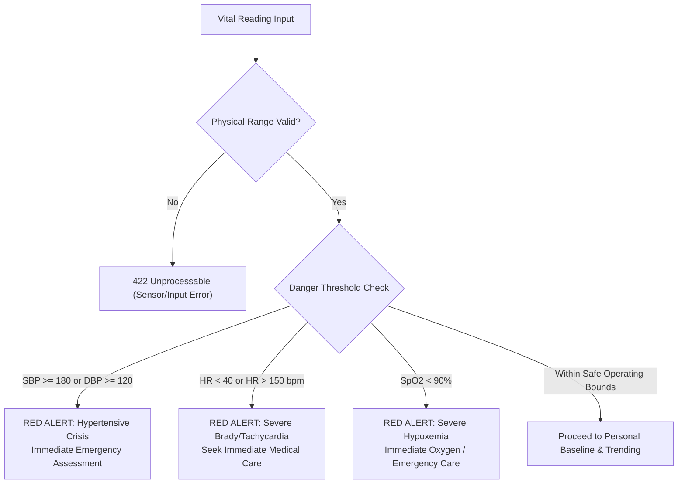

# CardioGuard AI — Deterministic Clinical Rules Specification

> [!IMPORTANT]
> **Specification Version**: `1.0.0`  
> **Effective Date**: October 2026  
> **Clinical Review Board**: CardioGuard Clinical Safety Group  
> **Rule Execution Engine**: Synchronous, zero-dependency in-memory matcher (`backend/app/services/safety_rules.py` and mobile local engine)

---

## 1. Acute Cardiovascular Emergency Symptom Rules

The engine executes deterministic regular expression matching and symptom-flag analysis. If any of the following symptom clusters are identified, the system immediately trips an emergency alert state (`SEVERITY_RED`).

### 1.1 High-Acuity Red-Flag Triggers

| Rule ID | Symptom Trigger | Clinical Rationale | System Action |
|---|---|---|---|
| `EMG-001` | **Chest pain / pressure / tightness** radiating to left arm, neck, jaw, back, or epigastrium | Hallmark presentation of Acute Coronary Syndrome (ACS) / Myocardial Infarction | Trigger Emergency Mode; prompt immediate 112/911 call |
| `EMG-002` | **Sudden severe tearing / ripping chest or back pain** | Clinical hallmark of Acute Aortic Dissection | Trigger Emergency Mode; prompt immediate 112/911 call |
| `EMG-003` | **Acute shortness of breath (dyspnea) at rest** with or without chest heaviness | Potential Acute Pulmonary Embolism, Acute Pulmonary Edema, or ACS equivalent | Trigger Emergency Mode |
| `EMG-004` | **Syncope (fainting) or near-syncope** associated with palpitations or chest pain | Potential sustained ventricular tachycardia, complete heart block, or hemodynamic instability | Trigger Emergency Mode |
| `EMG-005` | **Sudden neurological deficits** (facial droop, unilateral arm weakness, slurred speech - FAST criteria) | Acute Ischemic Stroke or Hemorrhagic Stroke | Trigger Emergency Mode |

---

## 2. Vital Sign Danger Ranges & Triage Thresholds

Measurements outside physiological boundaries are categorized according to standardized clinical guidelines (AHA/ACC 2017 Hypertension Guidelines; Surviving Sepsis / NEWS2 protocols).



### 2.1 Blood Pressure Thresholds (Adults $\ge 18$ yrs)

| Category | Systolic (mmHg) | Diastolic (mmHg) | Action & Feedback |
|---|---|---|---|
| **Normal** | $< 120$ | **and** $< 80$ | Normal cardiovascular baseline. Maintain healthy lifestyle. |
| **Elevated** | $120 - 129$ | **and** $< 80$ | Mild elevation. Recheck periodically; lifestyle interventions. |
| **Hypertension Stage 1** | $130 - 139$ | **or** $80 - 89$ | Consult physician for clinical management. |
| **Hypertension Stage 2** | $140 - 179$ | **or** $90 - 119$ | Clinical review required. Schedule physician appointment. |
| **Hypertensive Crisis** | $\ge 180$ | **or** $\ge 120$ | **CRITICAL RED**: Re-check immediately. If accompanied by chest pain, headache, or dyspnea, call 112/911 immediately. |

### 2.2 Heart Rate Thresholds (Resting Adult)

| Category | Range (bpm) | Action & Feedback |
|---|---|---|
| **Severe Bradycardia** | $< 40$ | Critical alert if symptomatic (dizziness, fatigue, syncope). |
| **Mild / Moderate Bradycardia** | $40 - 50$ | Common in conditioned athletes; prompt re-check if sedentary. |
| **Normal Resting Heart Rate** | $50 - 100$ | Expected physiologic resting range. |
| **Mild Tachycardia** | $101 - 149$ | Evaluate for stress, caffeine, fever, dehydration. |
| **Severe Tachycardia** | $\ge 150$ | **CRITICAL RED**: Urgent medical evaluation recommended. |

### 2.3 Peripheral Capillary Oxygen Saturation ($SpO_2$)

| Category | Range ($SpO_2\%$) | Action & Feedback |
|---|---|---|
| **Normal** | $95.0\% - 100.0\%$ | Normal arterial oxygen saturation. |
| **Mild Hypoxemia** | $90.0\% - 94.9\%$ | Monitor closely; retest on warm finger. Prompt physician consult. |
| **Severe Hypoxemia** | $< 90.0\%$ | **CRITICAL RED**: Call emergency services; supplemental oxygen needed. |

---

## 3. Anti-Reassurance Vocabulary Filter

The system scans all generative responses against a forbidden phrase blacklist:

```json
[
  "you have nothing to worry about",
  "your symptoms are not serious",
  "this is definitely just anxiety",
  "this is just indigestion",
  "no need to go to the hospital",
  "your vitals are normal so you are fine",
  "you can safely ignore this pain",
  "it is completely safe to wait"
]
```
If any phrase or semantic equivalent is matched, the response is rejected and overwritten with conservative safety guidance.

---

## 4. Rule Governance & References

1. **Whelton PK, et al.** *2017 ACC/AHA/AAPA/ABC/ACPM/AGS/APhA/ASH/ASPC/NMA/PCNA Guideline for the Prevention, Detection, Evaluation, and Management of High Blood Pressure in Adults.* J Am Coll Cardiol. 2018;71(19):e127-e248.
2. **Amsterdam EA, et al.** *2014 AHA/ACC Guideline for the Management of Patients with Non–ST-Elevation Acute Coronary Syndromes.* Circulation. 2014;130(25):e344-e426.
3. **Royal College of Physicians.** *National Early Warning Score (NEWS) 2: Standardising the assessment of acute-illness severity in the NHS.* London: RCP, 2017.
