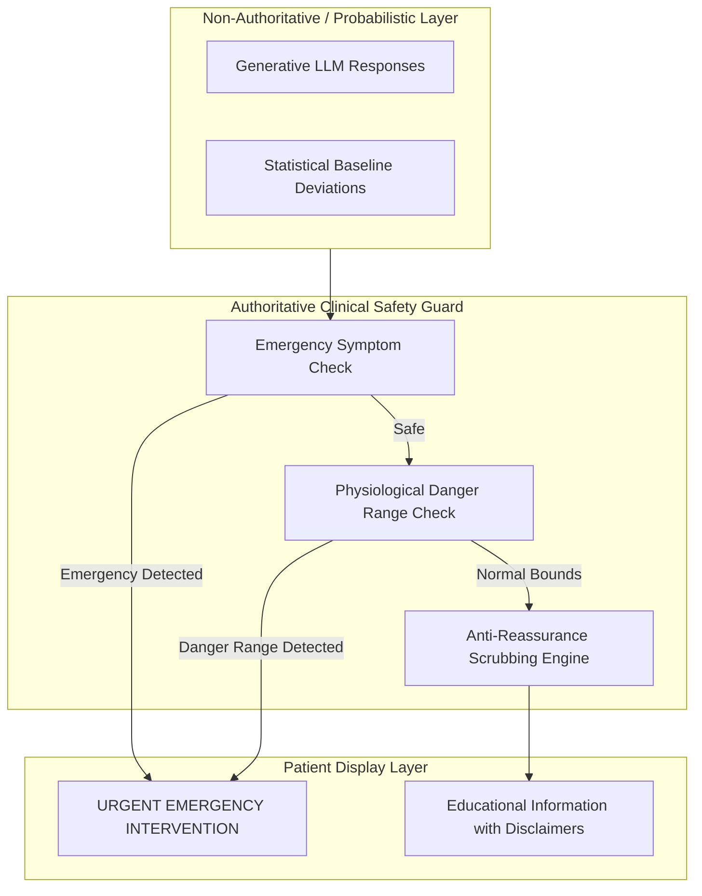

# CardioGuard AI — Clinical Safety Principles

> [!IMPORTANT]
> **Primary Clinical Directive**: *Primum non nocere* (First, do no harm). In digital health software, harm often arises from **false reassurance**, missed acute presentations, or algorithmic hallucinations. CardioGuard AI is architected from the foundation to enforce deterministic safety over all statistical inferences.

---

## 1. Core Safety Principles

### Principle 1: Deterministic Safety Rules Take Absolute Precedence
Probabilistic systems (machine learning models, neural networks, LLMs) can fail in unpredictable ways when presented with out-of-distribution inputs or subtle linguistic cues. Therefore:
- Hardcoded clinical safety rules operate as an **authoritative supervisory layer**.
- If a patient enters symptoms of an acute myocardial infarction, **no LLM prompt, risk score, or normal vital sign reading is permitted to override an immediate emergency warning**.

### Principle 2: Strict Prohibition of False Reassurance
The most dangerous failure mode in consumer health technology is telling a patient experiencing an active coronary occlusion that they are fine.
- **Rule**: Normal vital signs (e.g., Blood Pressure 120/80 mmHg, SpO2 99%, Heart Rate 72 bpm) **do not rule out an acute coronary syndrome**.
- The system is programmatically forbidden from generating phrases such as:
  - *"Your vitals are completely normal, so you don't need to worry."*
  - *"This chest pain is likely just indigestion or stress."*
  - *"Wait until morning to see if the symptoms go away."*

### Principle 3: Clear Separation of Concerns
The system maintains strict architectural boundaries between:
1. **Clinical Safety Layer**: Fully deterministic, zero-dependency, hardcoded rules.
2. **Deterministic Risk Calculators**: Published mathematical formulas (Framingham).
3. **Statistical Anomaly Engines**: Historical baseline deviations.
4. **Generative LLM Assistant**: Non-authoritative, educational content only.

---

## 2. Emergency Override Architecture

When an emergency trigger is tripped:
1. **UI Hijack**: The application UI transitions immediately to a high-contrast emergency state.
2. **Suppression of Generative Text**: Any ongoing streaming from an LLM or complex visualization is aborted.
3. **Call-to-Action Prioritization**: The only prominent user actions become:
   - **Call 112 / 911** (Native telephone deep-link).
   - **Notify Emergency Contacts** (Direct SMS / Dispatch).
   - **Sit / Lie Down and Cease Physical Exertion**.

---

## 3. Transparency & Limitation Governance

- Every calculated score (e.g., Framingham) is presented with:
  - The equation source.
  - The population cohort it was calibrated on.
  - A permanent visible disclaimer that it is an estimate, not a diagnosis.
- Patients are continually informed of system boundaries: CardioGuard AI does not replace a physician, cannot write prescriptions, and does not conduct live 24/7 telemetry monitoring.

---

## 4. Clinical Review & Versioning Requirements

All clinical rules and emergency keyword lists:
1. Must be versioned under strict semantic versioning (e.g., `clinical_rules_v1.0.0.json`).
2. Must be reviewed, approved, and digitally signed by a practicing board-certified cardiologist or emergency medicine physician before release to production.
3. Changes to clinical safety rules require unit test coverage demonstrating $100\%$ detection of standard emergency scenarios.
