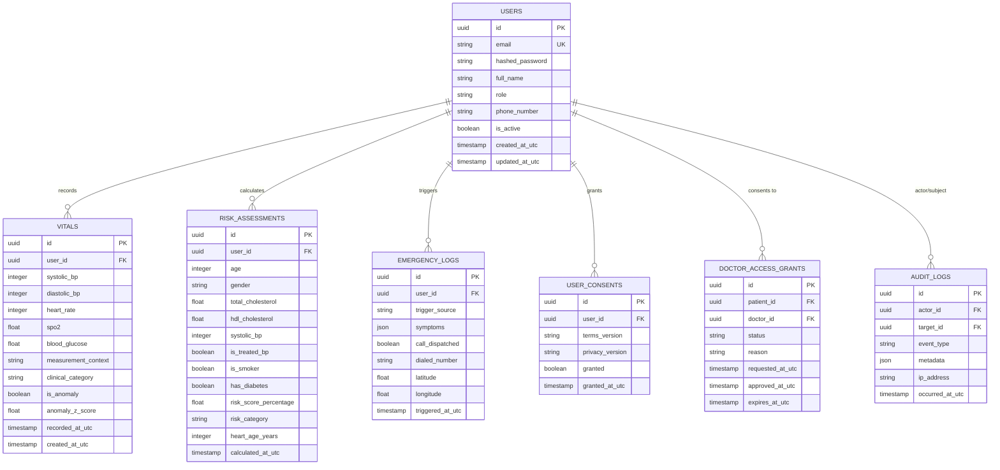

# CardioGuard AI — Database Design & Schema Architecture

> [!IMPORTANT]
> **Data Integrity & Storage Standards**:
> 1. All timestamps are strictly stored in **UTC** as ISO-8601 strings or `TIMESTAMP WITH TIME ZONE` columns. Local time conversions are performed exclusively on the presentation layer.
> 2. Database schemas are dual-compatible with **SQLite** (local development and offline caching) and **PostgreSQL 15+** (production).

---

## 1. Entity-Relationship (ER) Diagram

---

## 2. Table Specifications & Data Dictionaries

### 2.1 `users`
Primary identity and authentication table.
- `id` (UUID, PK): Cryptographically random unique identifier.
- `email` (VARCHAR(255), UNIQUE, NOT NULL): Primary login handle; normalized to lowercase.
- `hashed_password` (VARCHAR(255), NOT NULL): Password hash generated using Argon2id ($m=65536, t=3, p=4$).
- `full_name` (VARCHAR(150), NOT NULL): Legal or preferred name.
- `role` (VARCHAR(30), NOT NULL): `patient`, `doctor`, or `admin`.
- `phone_number` (VARCHAR(30), NULLABLE): E.164 formatted telephone number.
- `is_active` (BOOLEAN, DEFAULT TRUE): Soft-disable flag.
- `created_at_utc` / `updated_at_utc` (TIMESTAMP WITH TIME ZONE, NOT NULL).

### 2.2 `vitals`
Longitudinal physiological measurements.
- `id` (UUID, PK).
- `user_id` (UUID, FK -> `users.id`, ON DELETE CASCADE).
- `systolic_bp` / `diastolic_bp` (SMALLINT, NULLABLE): Blood pressure in mmHg ($30 \le \text{sys} \le 300$, $20 \le \text{dia} \le 200$).
- `heart_rate` (SMALLINT, NULLABLE): Beats per minute ($20 \le \text{bpm} \le 300$).
- `spo2` (NUMERIC(4, 1), NULLABLE): Peripheral capillary oxygen saturation percentage ($50.0 \le \text{spo2} \le 100.0$).
- `blood_glucose` (NUMERIC(5, 1), NULLABLE): Blood glucose in mg/dL ($20.0 \le \text{glucose} \le 1000.0$).
- `measurement_context` (VARCHAR(40)): `resting`, `post_exercise`, `fasting`, `post_prandial`.
- `clinical_category` (VARCHAR(40)): Evaluated category (e.g., `NORMAL`, `ELEVATED`, `HYPERTENSION_STAGE_1`, `HYPERTENSION_STAGE_2`, `HYPERTENSIVE_CRISIS`).
- `is_anomaly` (BOOLEAN, DEFAULT FALSE): Anomaly engine verdict.
- `anomaly_z_score` (NUMERIC(4, 2), NULLABLE): Statistical deviation score.
- `recorded_at_utc` (TIMESTAMP WITH TIME ZONE, NOT NULL): Actual time of clinical measurement.

### 2.3 `risk_assessments`
Historical record of Framingham cardiovascular risk calculations.
- `id` (UUID, PK).
- `user_id` (UUID, FK -> `users.id`, ON DELETE CASCADE).
- `age`, `gender`, `total_cholesterol`, `hdl_cholesterol`, `systolic_bp`, `is_treated_bp`, `is_smoker`, `has_diabetes`: Input biometrics.
- `risk_score_percentage` (NUMERIC(4, 1)): Computed 10-year risk percentage.
- `risk_category` (VARCHAR(20)): `LOW`, `MODERATE`, `HIGH`.
- `heart_age_years` (SMALLINT): Vascular heart age equivalent.
- `calculated_at_utc` (TIMESTAMP WITH TIME ZONE, NOT NULL).

### 2.4 `doctor_access_grants`
Explicit consent authorization linking patients to healthcare providers.
- `id` (UUID, PK).
- `patient_id` (UUID, FK -> `users.id`, ON DELETE CASCADE).
- `doctor_id` (UUID, FK -> `users.id`, ON DELETE CASCADE).
- `status` (VARCHAR(30)): `PENDING`, `ACTIVE`, `REVOKED`, `EXPIRED`.
- `reason` (TEXT): Justification provided by doctor.
- `requested_at_utc`, `approved_at_utc`, `expires_at_utc`.

### 2.5 `emergency_logs`
High-reliability audit log of urgent and emergency workflows.
- `id` (UUID, PK).
- `user_id` (UUID, FK -> `users.id`, ON DELETE SET NULL).
- `trigger_source` (VARCHAR(50)): `MANUAL_SOS_BUTTON`, `CRITICAL_VITALS_RULE`, `ASSISTANT_OVERRIDE`.
- `symptoms` (JSONB / TEXT): Array of selected red-flag symptoms.
- `call_dispatched` (BOOLEAN).
- `dialed_number` (VARCHAR(20)).
- `latitude` / `longitude` (NUMERIC(9, 6), NULLABLE).
- `triggered_at_utc` (TIMESTAMP WITH TIME ZONE, NOT NULL).

### 2.6 `audit_logs`
Immutable compliance and security record.
- `id` (UUID, PK).
- `actor_id` (UUID, FK -> `users.id`, ON DELETE SET NULL).
- `target_id` (UUID, NULLABLE).
- `event_type` (VARCHAR(60)): e.g., `LOGIN_SUCCESS`, `RECORD_ACCESSED`, `CONSENT_REVOKED`.
- `metadata` (JSONB / TEXT): Non-sensitive contextual attributes.
- `ip_address` (VARCHAR(45), NULLABLE).
- `occurred_at_utc` (TIMESTAMP WITH TIME ZONE, NOT NULL).

---

## 3. Indexing Strategy

To support sub-millisecond query responses for high-volume time-series vitals and access controls:

| Table | Index Name | Columns | Purpose |
|---|---|---|---|
| `users` | `ix_users_email` | `email` (UNIQUE) | Fast credential lookups on login |
| `vitals` | `ix_vitals_user_recorded` | `user_id, recorded_at_utc DESC` | Time-series charting and rolling baseline calculations |
| `vitals` | `ix_vitals_anomaly` | `user_id, is_anomaly` | Clinical alert filtering |
| `risk_assessments` | `ix_risk_user_calculated` | `user_id, calculated_at_utc DESC` | Patient risk trajectory viewing |
| `doctor_access_grants` | `ix_access_patient_doc` | `patient_id, doctor_id, status` | RBAC consent verification queries |
| `audit_logs` | `ix_audit_occurred` | `occurred_at_utc DESC` | Compliance auditing and forensics |

---

## 4. Timestamp Handling Standard

All database models inherit from a standardized base timestamp model:
1. `CURRENT_TIMESTAMP` in SQL is always configured to timezone `UTC`.
2. Mobile and web clients serialize datetime payloads into ISO-8601 strings with explicit `Z` suffix (e.g., `2026-10-17T15:00:00Z`).
3. Local presentation applies the browser or mobile device timezone at the view component layer only.

---

## 5. Data Retention & Archival Policy

- **Active Vital Telemetry**: Stored in primary storage for 5 years to support longitudinal trending.
- **Audit Logs**: Retained in append-only storage for a minimum of 7 years in accordance with healthcare compliance guidelines.
- **Deleted Accounts**: In compliance with the "Right to Erasure", account identifiers are purged, and vitals are either anonymized for epidemiological metrics (subject to prior opt-in) or permanently purged.
