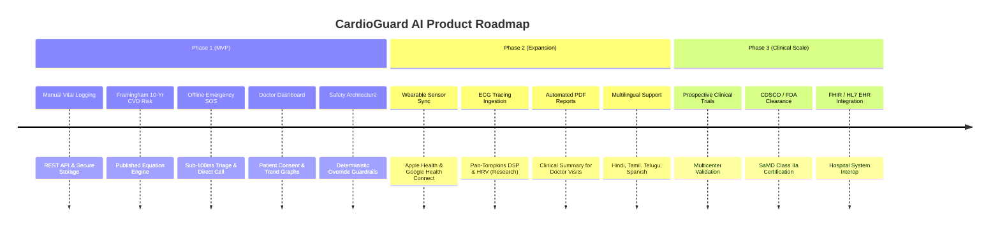

# CardioGuard AI — Product Requirements Document (PRD)

> [!NOTE]
> **Document Status**: Active  
> **Product Name**: CardioGuard AI  
> **Target Release**: Phase 1 MVP  
> **Classification**: Cardiovascular Health Tracking & Clinical Decision-Support Research Platform

---

## 1. Product Vision

Cardiovascular diseases (CVDs) represent the leading cause of mortality globally, with a disproportionately accelerating burden in low- and middle-income countries. CardioGuard AI bridges the gap between daily patient self-monitoring and clinical physician review through an intelligent, safety-first platform.

By uniting deterministic clinical triage rules, standardized cardiovascular risk scoring (Framingham), personal statistical baseline tracking, and secure doctor-patient collaboration, CardioGuard AI empowers patients to track their cardiovascular wellness while ensuring life-threatening emergencies receive zero-delay offline triage.

---

## 2. Target Personas & User Profiles

### 2.1 Primary Persona: The At-Risk Patient (Ramesh, 54)
- **Profile**: Diagnosed with Stage 1 Hypertension and borderline hyperlipidemia; sedentary office worker.
- **Needs**: Simple logging of home BP readings, tracking heart rate trends, understanding risk factors in plain language, having a clear emergency SOS button if chest discomfort strikes.
- **Frustrations**: Unreadable paper logbooks; fear of knowing whether a sudden pressure spike is dangerous or artifactual.

### 2.2 Secondary Persona: The Attending Cardiologist (Dr. Priya, 42)
- **Profile**: Interventional cardiologist managing 250+ outpatients.
- **Needs**: Rapidly review authenticated 30-day blood pressure and heart rate trends before a 10-minute consultation; receive notification only of critical hypertensive trends with explicit patient consent.
- **Frustrations**: Sifting through scattered phone screenshots, inaccurate recall by patients, unvalidated AI apps giving dangerous medical reassurance.

---

## 3. Product Feature Matrix & Phasing

### 3.1 Phase 1 (MVP — Current Build)
- **Authentication & RBAC**: Argon2id password hashing, JWT bearer tokens, role separation (Patient, Doctor, Admin).
- **Vital Sign Telemetry**: Daily logging of SBP, DBP, Heart Rate, SpO2, and Blood Glucose with physical boundary validation.
- **Deterministic Clinical Rules**: Instant classification into AHA/ACC hypertension stages and hypertensive crisis alerting.
- **Framingham Cardiovascular Risk Engine**: Calculation of 10-year CVD risk percentage, risk category, and heart age.
- **Offline-First Emergency Flow**: Direct one-tap emergency call (112 / 911), symptom checklist, and local dispatch guidance without waiting on API responses.
- **Doctor Web Portal**: Patient roster, access requests, consent verification, and longitudinal chart visualization.
- **Safety Guardrail Architecture**: Pre- and post-execution LLM filtering forbidding false reassurance.

### 3.2 Phase 2 (Wearables & Research Analytics)
- Direct Bluetooth Low Energy (BLE) peripheral sync for omron cuffs and pulse oximeters.
- Apple HealthKit and Android Health Connect ingestion pipelines.
- Experimental ECG waveform processing pipeline (research-only QRS / HRV extraction).
- Exportable clinical encounter PDF summary reports.

### 3.3 Phase 3 (Accredited Clinical Integration)
- Multi-site clinical validation trials.
- FHIR (Fast Healthcare Interoperability Resources) SMART on FHIR integration for Epic and Cerner EHRs.
- Regulatory clearance as a Software-as-a-Medical-Device (SaMD).

---

## 4. Success Metrics & Key Performance Indicators (KPIs)

| Domain | Metric | Target Objective |
|---|---|---|
| **Safety** | False Reassurance Rate during Emergency Symptoms | **0.0%** (Zero Tolerance) |
| **Performance** | Emergency Screen Client Render Latency | **$< 100\text{ ms}$** |
| **Performance** | API P99 Latency for Vitals Ingestion | **$< 250\text{ ms}$** |
| **Engagement** | Patient 30-day Vital Sign Adherence | $\ge 70\%$ active weekly logs |
| **Privacy** | Unauthorized Record Access Incidents | **0** |

---

## 5. Non-Functional Requirements (NFRs)

1. **Security & Privacy**:
   - In-transit encryption via TLS 1.3 with HSTS.
   - At-rest encryption using AES-256 for persistent database storage.
   - Compliance readiness for HIPAA (US) and Digital Personal Data Protection Act (DPDPA 2023, India).
2. **Reliability & Availability**:
   - $99.9\%$ uptime for REST API tier.
   - 100% offline uptime for emergency guidance client module.
3. **Auditability**:
   - Append-only audit logs capturing all read/write events on patient health records.
   - UTC timestamping across all persistence tiers.
