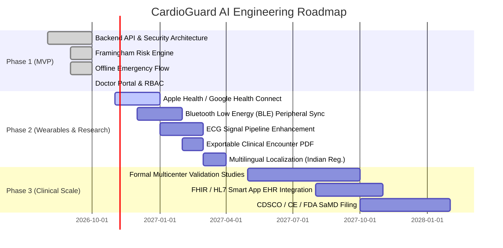

# CardioGuard AI — Engineering & Product Roadmap

This roadmap outlines the phased development, feature milestones, and regulatory roadmap for CardioGuard AI.

---

## Roadmap Overview

---

## 1. Phase 1 (MVP) — Current Implementation

### Focus: Solid Foundations, Deterministic Safety, and Baseline Vitals
- **Core Platform Architecture**:
  - FastAPI asynchronous backend with SQLAlchemy ORM and Alembic migrations.
  - Role-Based Access Control (Patient, Doctor, Administrator) powered by Argon2id and JWT bearer tokens.
  - Relational database schema with SQLite (local) and PostgreSQL (production).
- **Clinical Logic & Safety Engine**:
  - Published Framingham 10-year CVD risk score implementation (D'Agostino et al., 2008).
  - Deterministic clinical rules for blood pressure triage (AHA/ACC 2017) and hypertensive crisis alerting.
  - Zero-latency offline emergency guidance screen with single-tap 112/911 dispatch.
  - Health assistant with strict pre- and post-generation safety barriers preventing false medical reassurance.
- **Client Applications**:
  - Cross-platform React Native / Expo mobile app for patients.
  - Next.js 14 doctor dashboard for patient roster and trend inspection.

---

## 2. Phase 2 — Wearables, Waveforms & Advanced Clinical Reports

### Focus: Automated Ingestion, Advanced Waveform DSP, and Provider Utility
- **Wearable Sensor Integration**:
  - Ingestion from Apple HealthKit and Android Health Connect (resting heart rate, steps, nocturnal SpO2).
  - Bluetooth Low Energy (BLE) GATT profile communication for automated syncing with certified home blood pressure monitors (e.g., Omron, Beurer).
- **ECG Pipeline Expansion (Research Track)**:
  - Integration of PyTorch / ONNX models for multi-lead rhythm classification on benchmark research datasets (MIT-BIH, PTB-XL).
  - Advanced morphology tracking (ST-segment elevation/depression research prototypes).
- **Provider Tools**:
  - High-fidelity PDF Clinical Encounter Summary generation for outpatient visits.
  - Automated weekly digest for patients summarizing systolic/diastolic control percentages.
- **Accessibility & Localization**:
  - Full interface localization in Hindi, Tamil, Telugu, and Spanish.
  - Voice-guided emergency screen audio for low-literacy users.

---

## 3. Phase 3 — Validated Clinical Intelligence & Enterprise Interoperability

### Focus: Prospective Validation, Regulatory Clearance, and Health System Integration
- **Clinical Trial Validation**:
  - Prospective multicenter clinical trial evaluating algorithm reliability against certified cardiologist panels.
  - Formal publication of subgroup calibration across South Asian and diverse demographic cohorts.
- **Hospital EHR Integration**:
  - SMART on FHIR application launch within Epic MyChart and Cerner Millennium.
  - Bi-directional sync of blood pressure observations via standard HL7 FHIR `Observation` resources.
- **Regulatory Clearance & SaMD Certification**:
  - Quality Management System compliant with ISO 13485 and ISO 14971 risk management.
  - Submissions for CE-mark (EU MDR Class IIa) and CDSCO (India) Software-as-a-Medical-Device (SaMD).
