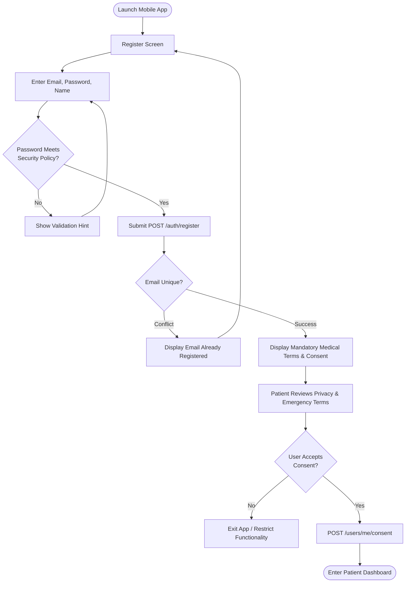
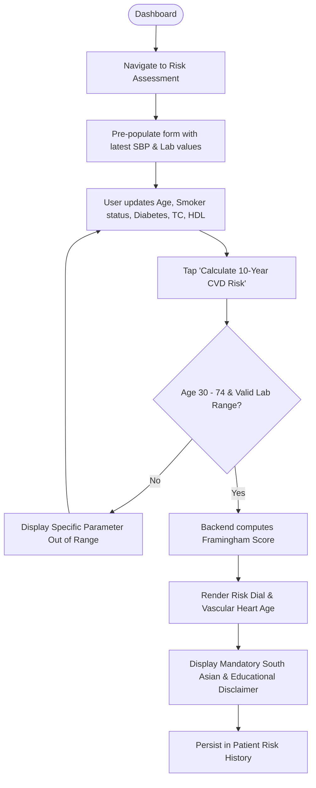
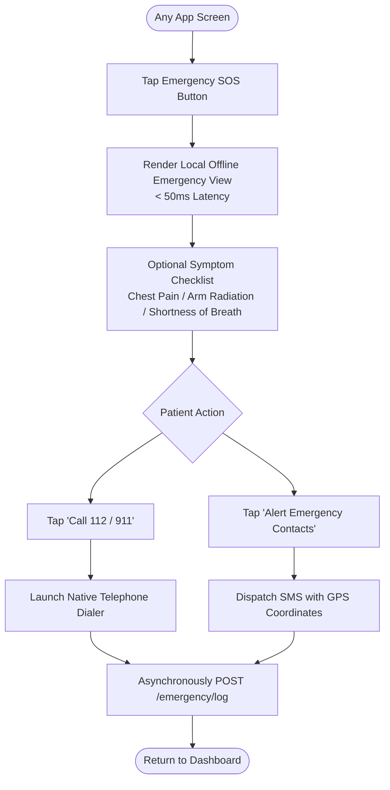
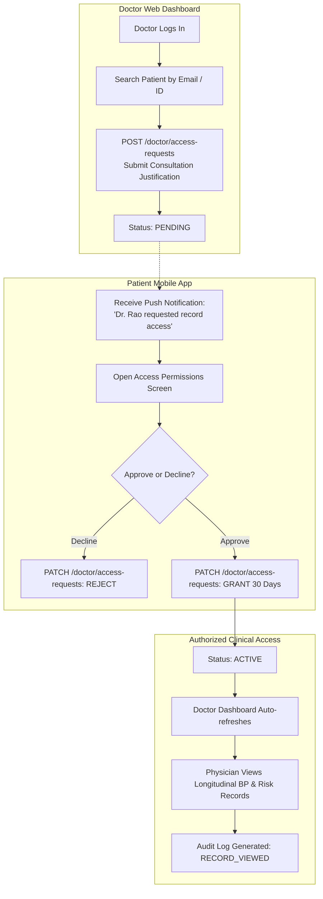

# CardioGuard AI — Product User Flows

This document details the primary end-user interaction pathways across the CardioGuard AI mobile application and web dashboard.

---

## 1. Registration, Onboarding & Terms Consent Flow



---

## 2. Vital Sign Recording & Trend Review Flow

```mermaid
flowchart TD
    Dash([Patient Dashboard]) --> TapRecord[Tap '+ Record Vitals']
    TapRecord --> VitalForm[Enter Systolic, Diastolic, Heart Rate, Glucose]
    VitalForm --> SubmitVital[Submit POST /vitals]
    SubmitVital --> SafetyCheck{Hypertensive Crisis?\nSBP >= 180 or DBP >= 120}
    
    SafetyCheck -->|Yes| RedBanner[DISPLAY RED URGENT ALERT\nInstruct Immediate Retest / 112 Call]
    SafetyCheck -->|No| AnomalyCheck{Baseline Outlier?\n|Z| > 3.0}
    
    AnomalyCheck -->|Yes| YellowNote[Save Vital + Suggest Rest & Retest]
    AnomalyCheck -->|No| NormalSave[Save Vital with Normal Category]
    
    RedBanner --> EmergencyOption{User chooses action}
    EmergencyOption --> TapCall[Tap Call Emergency]
    EmergencyOption --> TapDismiss[User Dismisses Alert]
    
    YellowNote --> ViewTrends[Render 30-Day Trend Visualizations]
    NormalSave --> ViewTrends
    ViewTrends --> Dash
```

---

## 3. Cardiovascular Risk Assessment Flow



---

## 4. Emergency Action Flow (Instant & Offline)



---

## 5. Doctor Access Request & Patient Consent Approval Flow


