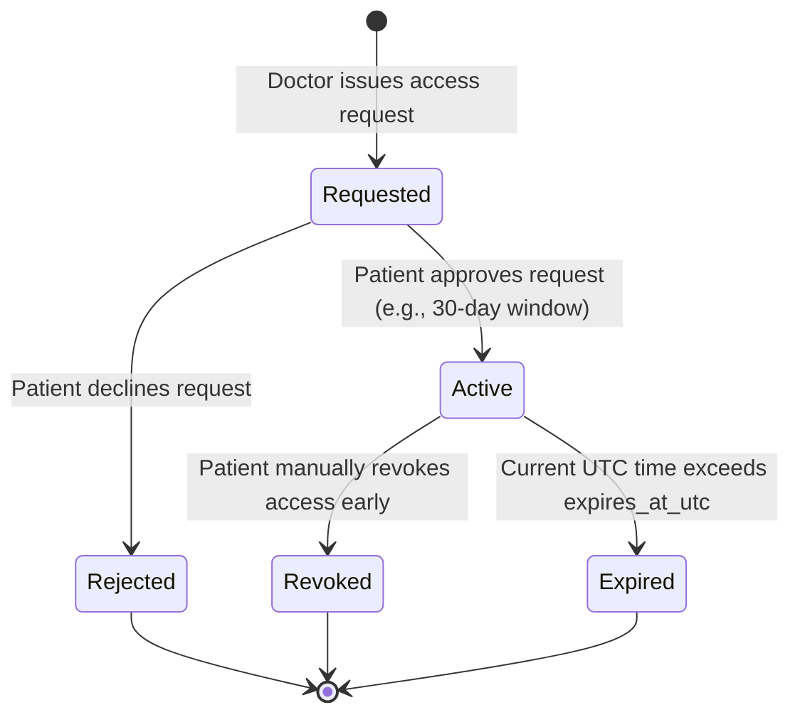

# CardioGuard AI — Role-Based Access Control (RBAC) & Authorization

> [!IMPORTANT]
> **Zero Trust Authorization Rule**: Authentication proves identity; authorization proves permission. A doctor cannot view a patient's medical records merely by holding the "doctor" role. Access strictly requires an **active, verified, and unexpired patient consent grant**.

---

## 1. System Roles & Hierarchies

CardioGuard AI establishes three primary discrete roles:

1. `patient`:
   - Owner of their personal health record.
   - May record vitals, compute risk scores, execute emergency flows, and grant/revoke physician access.
2. `doctor`:
   - Licensed medical practitioner.
   - Must undergo administrative verification of medical registration / license.
   - May submit access requests to patients and view records of consented patients only.
3. `admin`:
   - System operator and security administrator.
   - Responsible for verifying doctor credentials, system health monitoring, and compliance auditing.
   - **Explicitly barred from inspecting identifiable patient clinical vitals or ECG tracings** without an active forensic order.

---

## 2. Granular Permission Matrix

| Operation / Endpoint Group | Patient | Doctor (Consented) | Doctor (Unconsented) | Admin | Unauthenticated |
|---|:---:|:---:|:---:|:---:|:---:|
| `POST /auth/register` | Yes | Yes | Yes | Yes | Yes |
| `POST /auth/login` | Yes | Yes | Yes | Yes | Yes |
| `GET /users/me` | Self | Self | Self | Self | No |
| `POST /vitals` | Self | No | No | No | No |
| `GET /vitals` (Own records) | Self | No | No | No | No |
| `GET /vitals` (Patient records) | No | **Yes** | **No (403)** | **No (403)** | No |
| `POST /risk/calculate` | Self | Self / Patient | No | No | No |
| `POST /emergency/log` | Yes | Yes | Yes | Yes | Yes (Fallback) |
| `POST /doctor/access-requests` | No | Yes | Yes | No | No |
| `PATCH /doctor/access-requests` | Self (Grant/Revoke) | No | No | No | No |
| `POST /admin/verify-doctor` | No | No | No | **Yes** | No |
| `GET /admin/audit-logs` | No | No | No | **Yes** | No |

---

## 3. The Consent Lifecycle



### 3.1 Patient Sovereignty
- Patients receive immediate push notifications whenever an access request is lodged.
- Consent can be granted for configurable durations ($7$, $30$, or $90$ days).
- A patient can revoke access with a single tap on the permissions screen, taking effect immediately.

---

## 4. Doctor Verification Workflow

To prevent malicious impersonation of healthcare providers:
1. Upon registration with `role="doctor"`, the account status has `is_verified_practitioner = False`.
2. The physician must submit their Medical Registration Number (MRN), State Medical Council details, and clinic address.
3. An administrative compliance officer verifies the credentials against the national registry (e.g., National Medical Commission in India).
4. Once verified, `is_verified_practitioner` is set to `True`, unlocking the ability to issue access requests to patients.

---

## 5. API Authorization Enforcement Implementation

Authorization is enforced at the FastAPI dependency layer via composable security guards:

```python
# Conceptual FastAPI Dependency Architecture
def require_role(required_role: str):
    async def role_checker(current_user: User = Depends(get_current_active_user)):
        if current_user.role != required_role:
            raise HTTPException(
                status_code=status.HTTP_403_FORBIDDEN,
                detail=f"Operation requires {required_role} privileges."
            )
        return current_user
    return role_checker

async def verify_doctor_patient_consent(
    patient_id: UUID,
    current_doctor: User = Depends(require_role("doctor")),
    db: AsyncSession = Depends(get_db)
):
    grant = await db.scalar(
        select(DoctorAccessGrant).where(
            DoctorAccessGrant.patient_id == patient_id,
            DoctorAccessGrant.doctor_id == current_doctor.id,
            DoctorAccessGrant.status == "ACTIVE",
            DoctorAccessGrant.expires_at_utc > datetime.now(timezone.utc)
        )
    )
    if not grant:
        raise HTTPException(
            status_code=status.HTTP_403_FORBIDDEN,
            detail="Access forbidden: No active patient consent grant found."
        )
    return grant
```
