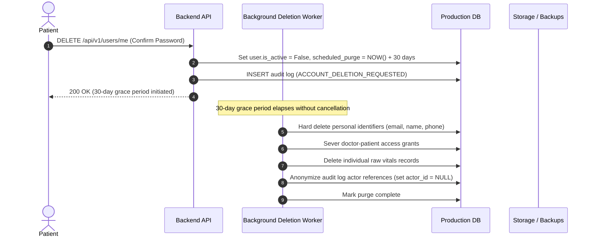

# CardioGuard AI — Data Retention, Archival & Destruction Policy

> [!IMPORTANT]
> **Policy Objective**: Define unambiguous lifecycles for user personal data, longitudinal clinical telemetry, audit trails, and database backups, balancing clinical continuity with patient privacy rights and legal compliance.

---

## 1. Data Retention Matrix

| Data Category | Examples | Active Retention Period | Cold Archive Period | Destruction Method |
|---|---|---|---|---|
| **Patient Account Profile** | Name, email, hashed credentials, demographic data | Duration of active account + 30 days post-deletion request | None | Cryptographic shredding & irreversible DB row deletion |
| **Longitudinal Vitals Telemetry** | Blood pressure, heart rate, glucose, SpO2 records | 5 years from recording date | 2 additional years in cold encrypted storage | Cryptographic deletion / anonymization |
| **Cardiovascular Risk History** | Framingham calculation records | 5 years | 2 years | Irreversible DB deletion |
| **Emergency Telemetry Logs** | SOS triggers, symptom selections, dispatch records | 3 years | 4 years (legal statute of limitations) | Secure overwrite |
| **Access Audit Logs** | Authentication events, doctor record views, consent grants | 7 years (mandated for clinical audit compliance) | None (retained in immutable WORM storage) | Automated lifecycle expiration |
| **Disaster Recovery Backups** | Full and incremental PostgreSQL snapshots | 30 days rolling window | 90 days offsite | Automated snapshot termination |

---

## 2. Deleted Account Processing Workflow

### 2.1 30-Day Grace Period
- To prevent accidental loss of vital medical histories, accounts enter a 30-day "Pending Purge" state upon user deletion request.
- Logging in during this window restores the account and halts destruction.
- Following day 30, execution is automated, irreversible, and permanent.

---

## 3. Audit Log Immutability

Audit records generated in `audit_logs` are subject to strict compliance rules:
1. **Append-Only Enforcement**: Database privileges for application runtime roles forbid `UPDATE` and `DELETE` queries on the `audit_logs` table.
2. **7-Year Retention**: Required to defend against medical malpractice litigation and regulatory audits.
3. **Data Sanitization**: Audit records contain user UUIDs and event types, but **never raw blood pressure values, passwords, or patient medical notes**.

---

## 4. Backup Retention & Disaster Recovery Safeguards

1. **Daily Incremental Backups**: Retained for 14 calendar days.
2. **Weekly Full Database Snapshots**: Retained for 30 calendar days.
3. **Monthly Cold Storage Archives**: Encrypted with separate KMS keys and retained for 90 days.
4. **Data Expiration in Backups**: Backups naturally expire and rotate out within 90 days. When an account is deleted from production, it will be completely cleared from all backup rotations upon the expiration of the 90-day cycle.
