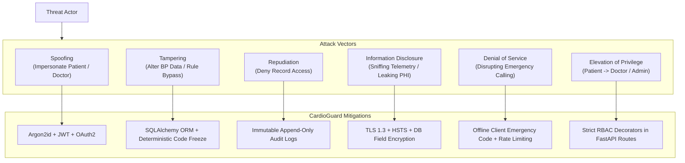

# CardioGuard AI — Security Threat Model (STRIDE Methodology)

> [!IMPORTANT]
> **Security Baseline**: Cardiovascular health data is Protected Health Information (PHI) and Personally Identifiable Information (PII). Protecting this information from exfiltration, unauthorized modification, or denial of service during an emergency is critical to human life safety.

---

## 1. Asset Inventory & Classification

| Asset ID | Asset Description | Sensitivity Level | Impact of Compromise |
|---|---|---|---|
| `AST-001` | **User Authentication Credentials** (Argon2id hashes, JWT secrets) | Critical | Full unauthorized account takeover |
| `AST-002` | **Patient Telemetry & Health Records** (Blood pressure, glucose, ECG, risk scores) | High (PHI / SPI) | Violation of patient privacy, blackmail, medical discrimination |
| `AST-003` | **Emergency Triage Pipeline** (SOS triggers, dispatch webhooks) | Critical (Life Safety) | Delayed emergency response leading to severe morbidity or mortality |
| `AST-004` | **Clinical Rule Engine** (Danger thresholds, symptom matchers) | Critical (Life Safety) | Malicious modification causing failure to alert during cardiac arrest |
| `AST-005` | **Audit Logs & Consent Records** (Access history, IP logs) | Medium | Inability to prove non-repudiation during compliance audits |

---

## 2. Threat Actors & Capabilities

1. **Malicious External Attacker**: Opportunistic or targeted actors attempting automated credential stuffing, API exploitation, SQL injection, or ransomware.
2. **Curious or Malicious Insider / Physician**: A verified healthcare professional attempting to view patient records without explicit patient consent.
3. **Compromised Client Device**: Malware or spyware running on a patient's rooted or jailbroken mobile device intercepting local tokens or sensor feeds.
4. **Adversarial Input Submitter**: Users or bots attempting prompt injection on the LLM health assistant to elicit dangerous medical advice or false reassurance.

---

## 3. STRIDE Threat Analysis & Mitigations

### 3.1 Spoofing (Identity Impersonation)
- **Threat**: Attacker creates fake doctor profile or hijacks patient session.
- **Mitigation**:
  - Physician accounts require manual administrative verification (`is_verified_practitioner=True`) before accessing any patient records.
  - JWT tokens have short validity (60 minutes access, rotating refresh tokens).
  - Passwords hashed with high-memory Argon2id.

### 3.2 Tampering (Data Modification)
- **Threat**: Attacker tampers with vital signs to fake normal readings or alter risk calculations.
- **Mitigation**:
  - Strong input validation using Pydantic models with physiological sanity bounds.
  - Object-relational mapping (SQLAlchemy 2.0) with parameterized queries eliminating SQL injection.
  - Deterministic clinical rules are hardcoded in source control, not dynamic runtime database strings.

### 3.3 Repudiation (Disavowing Actions)
- **Threat**: Doctor denies unauthorized access to an ex-patient's cardiac charts.
- **Mitigation**:
  - Structured, append-only `audit_logs` table records actor ID, target patient ID, action type, client IP address, and UTC timestamp for every record access.

### 3.4 Information Disclosure (Data Leakage)
- **Threat**: Eavesdropping on unencrypted Wi-Fi or API data exfiltration.
- **Mitigation**:
  - Compulsory TLS 1.3 in transit with `Strict-Transport-Security` (HSTS) headers.
  - No PHI logged in plaintext application logger outputs (telemetry values and PII are redacted from logs).
  - Patient data isolated by user tenancy checks at the database query layer.

### 3.5 Denial of Service (DoS)
- **Threat**: Distributed denial of service flood knocking out emergency API endpoints.
- **Mitigation**:
  - **Zero-Dependency Local Emergency Screen**: Mobile client runs emergency triage offline without contacting the server.
  - Nginx rate-limiting per IP address and endpoint.

### 3.6 Elevation of Privilege
- **Threat**: Authenticated patient elevates privileges to access other patients' vitals or access doctor administration endpoints.
- **Mitigation**:
  - Role-Based Access Control enforced at every endpoint dependency (`Depends(require_role("doctor"))`).
  - Active consent check verifies that `doctor_access_grants` table contains an unexpired grant for the requested `patient_id`.

---

## 4. Known Security Limitations in Local Development Environment

1. **Development SQLite**: In local development, SQLite does not encrypt the `.db` file at rest. Production deployments **must** use PostgreSQL with full-disk LUKS/dm-crypt or AWS RDS storage encryption (KMS).
2. **Local Mock Credentials**: Development environment keys (`.env.example`) must never be deployed to staging or production.
3. **CORS Headers**: Development CORS allows `localhost:3000` and Expo ports; production Nginx reverse proxy restricts CORS to verified production domain origins.
