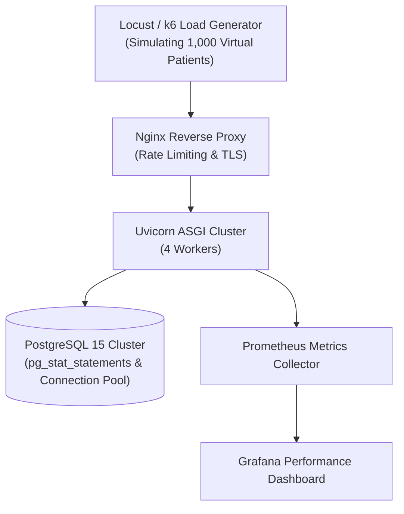

# CardioGuard AI — Performance & Stress Test Plan

> [!IMPORTANT]
> **Performance Mandates**:
> 1. Emergency endpoint availability must remain at **100%**, even under high system load.
> 2. P99 latency for vital signs ingestion must stay under **250 ms**.
> 3. Mobile emergency triage screen must render in under **100 ms** (offline).

---

## 1. Performance Testing Objectives

CardioGuard AI must maintain low latencies and zero degraded states for critical clinical pathways under varying load patterns:
- **Baseline Concurrency**: Normal daily load (100 simultaneous active users).
- **Peak Concurrency**: Morning and evening vital logging spikes (1,000 active concurrent users).
- **Stress & Soak Testing**: 4-hour sustained load testing for memory leaks in asynchronous worker pools.
- **Failover / Degraded Network Testing**: Emergency screen behavior under 3G, spotty cellular, or complete packet drop conditions.

---

## 2. Service Level Objectives (SLOs)

| Endpoint / Workflow | Target P95 Latency | Target P99 Latency | Max Error Rate |
|---|---|---|---|
| `POST /api/v1/auth/login` | $< 150\text{ ms}$ | $< 300\text{ ms}$ | $< 0.1\%$ |
| `POST /api/v1/vitals` | $< 100\text{ ms}$ | $< 250\text{ ms}$ | $< 0.05\%$ |
| `POST /api/v1/risk/calculate` | $< 50\text{ ms}$ | $< 120\text{ ms}$ | $< 0.01\%$ |
| `POST /api/v1/emergency/log` | $< 80\text{ ms}$ | $< 200\text{ ms}$ | $< 0.001\%$ |
| `GET /api/v1/vitals` (50 items) | $< 120\text{ ms}$ | $< 350\text{ ms}$ | $< 0.1\%$ |

---

## 3. Load Testing Architecture (Locust / k6)



---

## 4. Benchmark Execution Instructions

### 4.1 Running Load Tests with Locust
```bash
# Install load testing dependencies
pip install locust

# Execute vitals ingestion stress test
locust -f tests/performance/locustfile.py \
       --host=http://localhost:8000 \
       --users 500 \
       --spawn-rate 20 \
       --run-time 10m \
       --headless \
       --html tests/performance/report_load.html
```

### 4.2 Database Connection Pool Health Checks
Monitor connection exhaustion and slow queries during load testing:
```sql
-- Check active connections
SELECT count(*), state FROM pg_stat_activity GROUP BY state;

-- Identify top 5 slow queries by total time
SELECT query, calls, total_exec_time, mean_exec_time
FROM pg_stat_statements
ORDER BY total_exec_time DESC
LIMIT 5;
```
